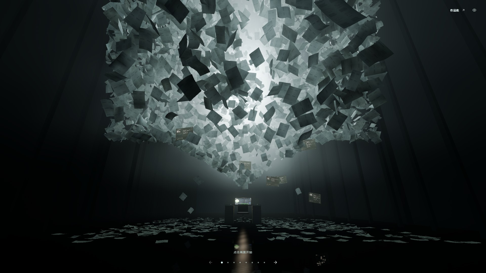
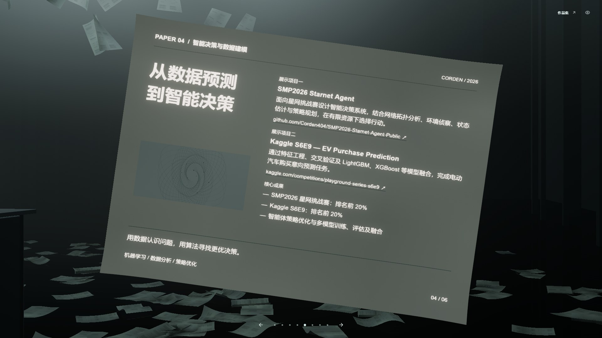

# 项目介绍

在线预览：**[GitHub Pages](https://corden404.github.io/Corden-Portfolio/)**

## [Qwen Beats Minecraft](https://github.com/Corden404/qwen-beat-minecraft)

由本地 Qwen 3.5 9B 驱动的 Minecraft 智能体，通过 llama.cpp 提供推理服务，让模型根据游戏状态进行任务规划与行动选择。

## [YOLO Enemy Detection](https://github.com/Corden404/YOLO-Enemy-Detection)

基于 YOLOv8n 的游戏人物检测工具，支持图片、视频、摄像头和视频流推理，包含视频抽帧、数据集准备、模型训练与验证流程。

## [WebCodex](https://github.com/yyjeqhc/webcodex)

开源 AI 开发平台，提供智能体运行、工具调用和工作结果展示等能力。我参与了桌面运行环境、MCP、浏览器自动化与文档处理等模块的开发。

## [SCAU Thesis Formatter Skill](https://github.com/Corden404/scau-thesis-formatter-skill)

面向华南农业大学论文和实验报告的排版 Skill，通过文档解析、Pandoc 和 Microsoft Word，将原稿整理为符合模板要求的 DOCX/PDF。

## [SMP2026 Starnet Agent](https://github.com/Corden404/SMP2026-Starnet-Agent-Public)

面向 SMP 2026 星网挑战赛的智能决策系统，结合网络拓扑分析、环境侦察与状态估计，在有限资源下规划行动。

## [Kaggle S6E9 — EV Purchase Prediction](https://www.kaggle.com/competitions/playground-series-s6e9)

电动汽车购买意向预测项目，通过特征工程、交叉验证及 LightGBM、XGBoost 等模型融合，对表格数据进行分类预测。

## [One World](https://github.com/Corden404/One-World)

包含十二幕可交互微缩世界的网页，通过深度视差、日夜光照变化与连续滚动，呈现可以探索的空间体验。

## [Particle Camera Flight](https://github.com/Corden404/particle-camera-flight)

结合 Blender 摄影机路径、Three.js 与粒子系统的交互网页，将三维雕塑转化为粒子形态，并让镜头移动与形态变化连续衔接。

## [MaoGai Quiz Tool](https://github.com/Corden404/MaoGai-Quiz-Tool)

基于 Vue 3、Tailwind CSS 与 Supabase 的在线学习平台，支持毛概与马原题目练习、错题复习、笔记分享、资料导出及跨设备进度同步。[在线使用](https://scau-test.top)。
